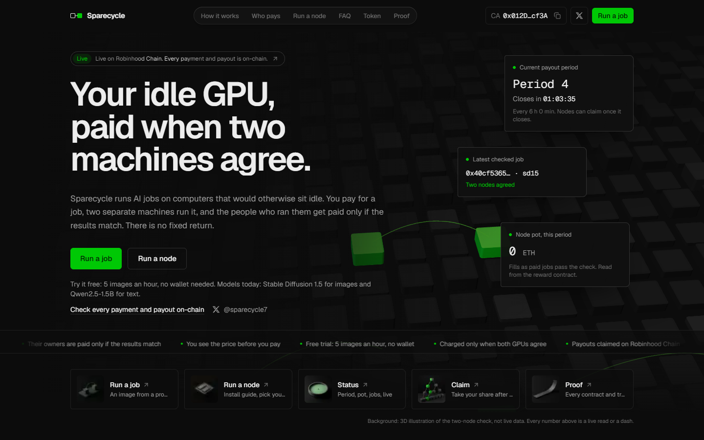
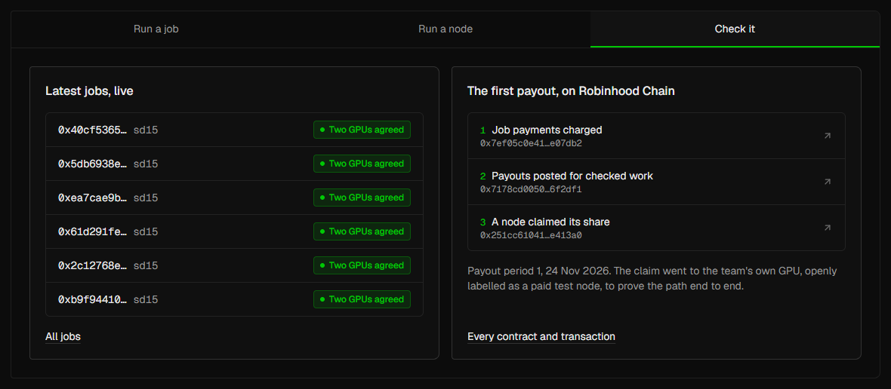
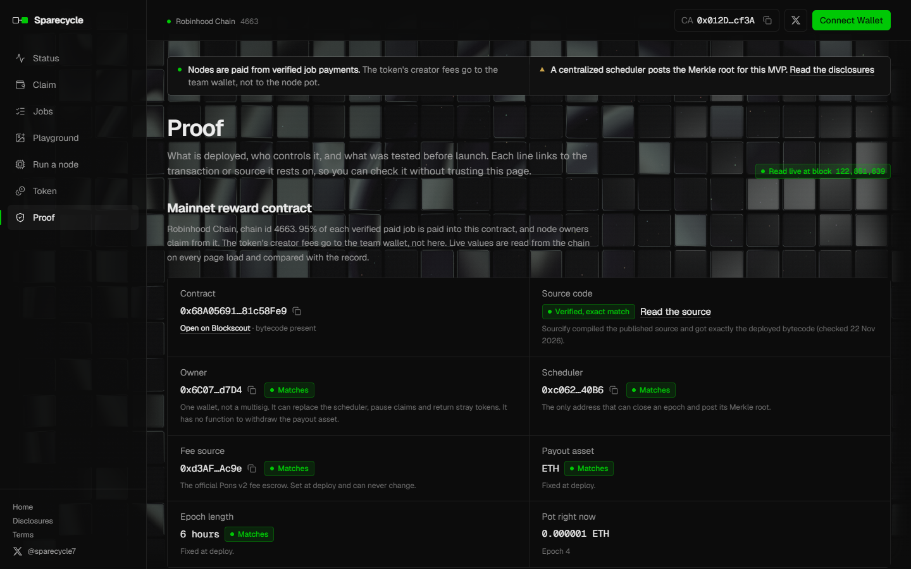
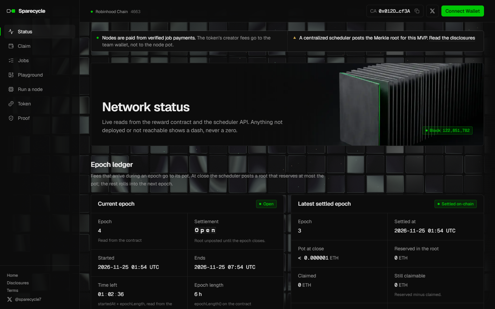
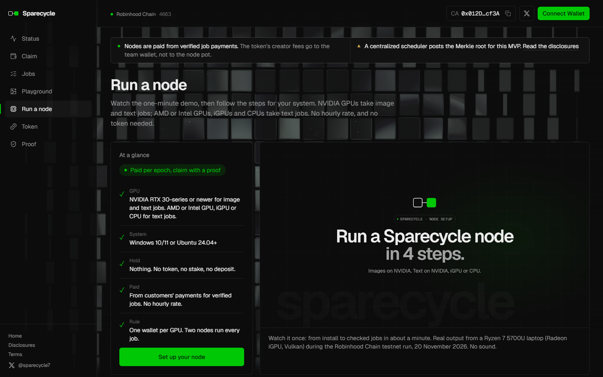
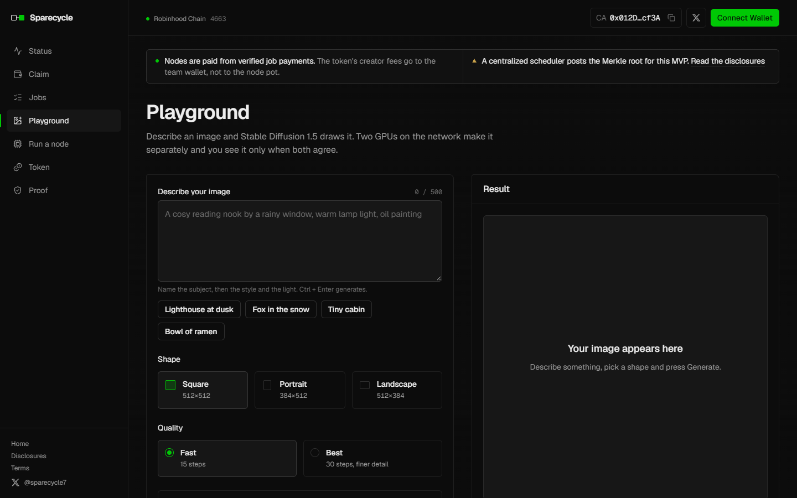
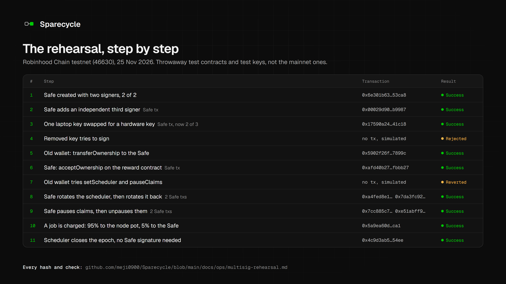

# Sparecycle

**Your idle GPU, paid when two machines agree.**

[](https://github.com/meji0900/Sparecycle/actions/workflows/ci.yml)
[](LICENSE)
[](https://robinhoodchain.blockscout.com/address/0x68A0569130551154FC1aABD71d99f65681c58Fe9)

[**Live site**](https://sparecycle.tech) · [Run a job](https://sparecycle.tech/playground) · [Run a node](https://sparecycle.tech/nodes) · [Network status](https://sparecycle.tech/app) · [Proof](https://sparecycle.tech/proof)



[](https://heyresearch.xyz/project/sparecycle?utm_source=badge&utm_medium=readme)

**Sparecycle** is a small network for idle GPUs. GPU owners run a node program, nodes run small AI jobs (Stable Diffusion 1.5 images and Qwen2.5-1.5B text), and every job is run by **two nodes with different owners** whose results are then compared. Nodes whose results match share an on-chain pot on Robinhood Chain, claimed with a Merkle proof. The pot is filled by **verified paid jobs** and by anything sent to the reward contract; there are no team top-ups and no promised returns.

| | |
| --- | --- |
| Site | **https://sparecycle.tech** (live on Robinhood Chain mainnet) |
| Network | **Robinhood Chain** (EVM, Arbitrum Orbit L2), chain id **4663**; testnet 46630 |
| Official token | **SpareCycle (SPARE)**, CA `0x012d695b94377e0c7b9edee3d824259baa37cf3a`, launched on **Pons v2** (factory `0x7eD598BcEf8bd9Edd8C97A195C6d13f40801EC7e`). Its creator fees go to the team wallet set at launch, **not** to the node pot; the site says so. |
| Earlier launch | **Sparecycle (CYCLE)** `0x2DbDcAf731ed6fDD55176183Ae7202a0D77F3A02`; its creator fees go to the reward contract |
| Reward contract | `SparecycleRewards` `0x68A0569130551154FC1aABD71d99f65681c58Fe9`: pot per epoch, Merkle claims, **no withdraw function**. Verified on Sourcify. Owner: the treasury Safe (2 of 3) since 25 Nov 2026. |
| Payments contract | `SparecycleJobPayments` `0x420716931E5Ff2a984840C6E95837d826a8BE7eB`: non-custodial prepaid balances; 95% of each verified job's charge to the node pot, 5% to the treasury Safe `0xb262E4436aD6760F91e987f14e2fAc5D6550c71B` (2 of 3 signers; all three keys held by the project owner). Verified on Sourcify. |
| Node pay | Verified paid jobs (**0.5 gwei per work unit**) plus anything sent to the reward contract. Free trial jobs (5 per hour per IP) share the same pot. |
| Repo | `github.com/meji0900/Sparecycle` |

Not financial or legal advice. Not a yield product. Tokens can go to zero. The scheduler is centralized in this MVP. This project is **not** IdleX; the node client code is adapted from an MIT-licensed repo, with attribution in [NOTICE](NOTICE).

---

## See it

Screenshots of the live site on 25 Nov 2026. Every number in them is read live from the chain or the scheduler.

| | |
| --- | --- |
| [](https://sparecycle.tech/) | [](https://sparecycle.tech/proof) |
| **Check it**: the latest jobs, each agreed by two GPUs, and the first payout (charge, root, claim) on Robinhood Chain | **Proof**: every contract read live and compared with the record, Sourcify-verified source |
| [](https://sparecycle.tech/app) | [](https://sparecycle.tech/nodes) |
| **Network status**: the open epoch, time left and the latest settled epoch | **Run a node**: what you need (no token, no stake), a one-minute demo and the install guide |
| [](https://sparecycle.tech/playground) | [](docs/ops/multisig-rehearsal.md) |
| **Playground**: an image from a prompt; free trial, or a fixed price shown before you pay | **Multisig rehearsal** (testnet): the owner moved from one wallet to a 2-of-3 Safe in 15 public transactions |

## What's new (25 Nov 2026)

- **Private job outputs, live.** A result can be read only by the browser that created the job (a per-job read secret) or by the wallet that paid (after a gasless sign-in). Knowing a job id is no longer enough; the old public `/output` link returns `410`. Details: [docs/private-outputs.md](docs/private-outputs.md).
- **GPU allowlist and periodic GPU challenge.** Nodes report their device; families that passed the cross-GPU bench are allowed, the rest are "untested". Both run in safe defaults for now (allowlist observe-only, challenge off). Details: [docs/gpu-support.md](docs/gpu-support.md), results in [bench/results/INDEX.md](bench/results/INDEX.md). Node client **0.3.0**.
- **Multisig ownership, live on mainnet.** The reward contract's owner is now the treasury Safe `0xb262E4436aD6760F91e987f14e2fAc5D6550c71B`, which needs 2 of its 3 signers ([signers changed](https://robinhoodchain.blockscout.com/tx/0x5082b606238c7fdfaf1aafcfa42b7726200664da84769e2105b22f45270e4c3d), [transfer](https://robinhoodchain.blockscout.com/tx/0xeafcacd3cdb3f50445ff6cace234756c9f21990a7d0def014eab64596afdb5a0), [accept](https://robinhoodchain.blockscout.com/tx/0x49470d4978f9ee6ff73a6d339c06a876fe98b5bcf20ad3c8287eccf14bdc4346)). The launch wallet's owner calls now revert. All three keys are held by the project owner, so this guards against one lost or leaked key, not against the project owner. Rehearsed first on testnet: [docs/ops/multisig-rehearsal.md](docs/ops/multisig-rehearsal.md).
- **First payout on mainnet (24 Nov 2026).** Job payments charged ([`0x7ef05c0e…`](https://robinhoodchain.blockscout.com/tx/0x7ef05c0e4126770474abbbcf8c58043e1ee771109a87d8ea669044488ce07db2)), payout root posted ([`0x7178cd00…`](https://robinhoodchain.blockscout.com/tx/0x7178cd00506c9a4f34263ba05312bd87dded8bf6c1bdfe7c820d3bf8e56f2df1)), a node claimed its share ([`0x251cc610…`](https://robinhoodchain.blockscout.com/tx/0x251cc6104160579bd282405392df6f2c28c7b2d6012d9df5cc136bb87ee413a0)). The claim went to the team's own GPU, openly labelled as a paid test node.

---

## Quick start

Requires **Node.js 24** (pinned in `package.json`) and, for the contracts, **Foundry**.

```bash
git clone https://github.com/meji0900/Sparecycle.git
```

Foundry's test library `forge-std` is not vendored: `npm run contracts:test` (via `contracts/tools/forge.mjs`) fetches it once into `contracts/lib/forge-std` at a pinned commit. OpenZeppelin comes from `node_modules`.

```bash
npm install
cp .env.example .env.local      # everything may stay empty: the site still runs and shows "Not deployed yet"
npm run dev                     # http://localhost:3000
```

Full local test without a GPU: `npm run e2e:local` starts anvil, the scheduler and two dev-runner nodes (job → check → close epoch → root → claim).

To run a node against the live network, see [Node program](#node-program) or the `/nodes` page.

---

## Contents

1. [See it](#see-it) · [What's new](#whats-new-25-nov-2026)
2. [How it works](#how-it-works)
3. [Money flow](#money-flow)
4. [Features](#features)
5. [Site pages](#site-pages)
6. [API](#api)
7. [Reward contract](#reward-contract)
8. [Payments contract](#payments-contract)
9. [Scheduler: jobs, checks, epochs](#scheduler-jobs-checks-epochs)
10. [Private job outputs](#private-job-outputs)
11. [GPU support](#gpu-support)
12. [Node program](#node-program)
13. [Bootstrap GPU pool (on demand)](#bootstrap-gpu-pool-on-demand)
14. [Sweep bot](#sweep-bot)
15. [Data backups](#data-backups)
16. [Folder structure](#folder-structure)
17. [Tests and checks](#tests-and-checks)
18. [Environment](#environment)
19. [Deploy (Railway + domain)](#deploy-railway--domain)
20. [Mainnet](#mainnet)
21. [Ownership and multisig](#ownership-and-multisig)
22. [Test results](#test-results)
23. [Security](#security)
24. [Data sources & licences](#data-sources--licences)
25. [Limitations](#limitations)
26. [Known gaps](#known-gaps)

---

## How it works

1. A **user** submits a small job at `/jobs` or `/playground` (image or text prompt), either as a free trial job or paid from a prepaid balance.
2. The **scheduler** (inside this Next.js app) gives the job to **two nodes**: different node keys, different owner wallets, different GPUs, same backend.
3. Both nodes run it, sign their result and send it back.
4. The scheduler **compares** the two results: images by 64-bit dHash (≤ 12 bits apart), text by edit-distance similarity (≥ 0.9). Match → the job is `agreed` and both nodes earn **work units**.
5. At the end of each **epoch** (6 hours by default), the scheduler charges paid jobs, splits that epoch's pot pro rata by work units, builds a **Merkle tree** and posts its root to the reward contract.
6. Node owners open **`/app/claim`**, connect a wallet and **claim** with a Merkle proof. Any unreserved pot rolls over to the next epoch.

Share formula: `share = pot × (your work units ÷ total work units)`, rounded down. Empty pot = no pay.

## Money flow

The pot in `SparecycleRewards` has two sources:

```
customer ──deposit──▶ SparecycleJobPayments (prepaid balance, only the customer can withdraw)
                         │  once per epoch the scheduler charges verified jobs (0.5 gwei per work unit)
                         ├──▶ 95% ──fund()──▶ SparecycleRewards (open epoch pot)
                         └──▶  5% ─────────▶ treasury Safe (2 of 3)

trader ──buy/sell CYCLE──▶ Pons bonding curve (standard fee + optional creator tax, buyback OFF)
                         │  Pons protocol share is taken first (protocolFeeShareBps, 30% when measured)
                         ▼
               sweep by the Pons operator  (operator.sweepCurve(curve); after graduation: hook.sweepPoolFees)
                         ▼
                 Pons fee escrow  ──claimFeesFromEscrow()──▶  SparecycleRewards (open epoch pot)
                                                                   │
  node A ┐  same job, two different nodes (different owner & GPU)   │ scheduler closes the epoch:
  node B ┘  results match (image dHash / text similarity) ──▶ eligible ─┤ pro rata by work unit, rounded down,
                                                                   │ Σ ≤ pot → Merkle root on-chain
                                                                   ▼
                                     node claims with a Merkle proof at /app/claim; leftover pot rolls over to the next epoch
```

- Paid jobs are **charged only when two results match; otherwise not charged**. A job whose results do not match, that expires without a verdict or that the safety check rejects is never charged; the price held for it is released (nothing moves on-chain, so nothing needs to be given back).
- Charges go out once per epoch as one batch. The 5% to the treasury is taken only from matched jobs, on the batch total and rounded down, so one job's 5% is a rounded share. The 95% goes to the open epoch's pot, which is split by work units across all matched jobs of that epoch, not to the nodes of one job in particular.
- Withdrawing: start a withdrawal any time, complete it after the lock (once the request's epoch and the next one have closed, or 2 days after the request at the latest).
- Free trial jobs pay nothing in, but their work units share the same pot as paid jobs.
- Anyone can add to the pot by sending to the reward contract (`fund`).
- **SPARE** creator fees go to the team wallet, not to this flow. **CYCLE** creator fees go to the reward contract as shown above.
- With creator tax 0, the pot receives about **0.7% of curve trading volume** (1% fee, 70% creator share).
- **Pons anti-sniper tax**: buys in the first 5 seconds after launch are taxed 99%, falling to 0 within 5 seconds; this tax is also counted as fees.
- The "reward contract as `creatorFeeRecipient`" path was proven on a **local fork of Robinhood mainnet** (`contracts/test/fork/PonsEscrowFork.t.sol`) and in a **rehearsal from the mainnet wallet** (`node scripts/mainnet.mjs rehearse`).

---

## Features

### Public site
- **Landing**: a 3D hero of the two-node check with live cards (current payout period, latest checked job, node pot); a three-tab product panel (**Run a job** with the real price, **Run a node** with the live pot and period clock, **Check it** with live jobs and the first payout's transactions); a three-step "How it works", who it is for, who pays the nodes (95% / 5%), FAQ and roadmap. Animated React Bits components.
- **Live on-chain status** on the landing page and in the app: epoch, pot, reserved, claimed, root; Pons factory parameters read live (`/api/chain`, 15-second cache).
- **Honest roadmap, FAQ and disclosures**: no fake stats, no "yield" wording, a single accent colour `#00C805`.
- **Fail closed**: any value not yet set (address, ticker, decision) shows as "Not configured / Not deployed yet" and is never made up.
- **Legal pages**: Terms and Privacy (placeholders until written by legal counsel) and full Disclosures (centralized scheduler, contract owner = a 2-of-3 Safe whose keys one person holds, Pons not audited, token risk).
- Still illustrations from Google Flow, `og.jpg` share card, icons.

### dApp
- **Network status** (`/app`): current epoch, pot, registered nodes per backend (cuda / vulkan / cpu), recent jobs, settled epochs, project GPU status ("Project GPUs (on demand)"), and a "Run by Sparecycle, unpaid" label on project nodes.
- **Claim** (`/app/claim`): connect a wallet (RainbowKit; WalletConnect when `NEXT_PUBLIC_WC_PROJECT_ID` is set), see your allocation per epoch, claim with a Merkle proof, with error messages that explain the cause (not settled, already claimed, claims paused, etc.).
- **3D Merkle tree** that highlights your proof path, and **"Check a proof"** to verify a proof without a wallet.
- **Submit jobs** (`/jobs`): SD 1.5 or Qwen2.5-1.5B, free trial jobs rate-limited per IP or paid from a prepaid balance, live status (queued → running → checking → agreed/disagreed/rejected/expired), image/text output of `agreed` jobs, visible only to this browser or the wallet that paid. Paid jobs get a private **invoice** (price, rounded 5% protocol cut, whether the results matched, charge status, the output's sha256 with an in-browser "check this hash", epoch and transaction links, Download JSON). The balance panel shows balance, held, withdrawal pending and available, starts a withdrawal in one click and completes it after the lock, and a **low-balance** warning appears below 5 jobs at the current price.
- **Playground** (`/playground`): generate an image in a few clicks; the result is private to this browser (or the paying wallet after a gasless sign-in).
- **Node guide** (`/nodes`): Windows/Linux installer downloads (with SHA256), a 61-second demo video, a **24-hour idle planner** that produces the `--hours` flag, wallet-linking steps and how to claim.
- **Token** (`/token`): token and curve addresses, live Pons reads (phase, fees, creator tax, pair, buyback, fee recipient, with a warning when the fee recipient is not the reward contract), token facts, launch decisions.
- **Proof** (`/proof`): live on-chain checks of the deployed contracts and setup transactions.
- **HEY Research builder card** (heyresearch.xyz) on `/proof` and `/token`; it appears once HEY publishes the project.

### Scheduler (server, inside Next.js)
- SQLite job queue (`node:sqlite`), 10-minute task lease, 6-hour expiry, limit of 500 open jobs.
- Two-node pairing: different node key, wallet and GPU UUID; same backend; a first task is only handed out when a matching partner is online.
- Verification: EIP-712 receipts, output hash recomputed, dHash/text similarity, SD safety checker.
- Node requests are signed with EIP-191 (60-second window, each signature single-use).
- Epoch closing manually (`npm run scheduler:close`, `POST /api/v1/epochs/close`) or **automatically** (`SCHEDULER_AUTOCLOSE=1`, checked every 15 seconds), with retry of the root posting on failure.
- Prompts are never returned; the public only sees `promptHash`.
- **On-demand GPU pool** (Vast.ai): starts project GPUs when jobs cannot yet be served, stops them when idle.

### Contracts (`contracts/`)
- `SparecycleRewards.sol`: pot per epoch, rollover, Merkle claim once per epoch, `claimFeesFromEscrow`, `fund`, `sync`, claim pause, scheduler rotation, `Ownable2Step`, no withdraw/mint/setPot.
- `SparecycleJobPayments.sol`: non-custodial prepaid balances for jobs (see [Payments contract](#payments-contract)).
- Foundry tests: unit, fuzz (512 runs), invariant (256 × 64, `fail_on_revert`), mainnet fork, ABI sync.
- Scripts: `Deploy.s.sol`, `DeployPayments.s.sol`, `Launch.s.sol` (Pons launch with fixed rules), `Rehearse.s.sol` (full dry run).

### Node program (`node-client/`)
- Backends `cuda` (image + text), `vulkan` (AMD/Intel GPU/iGPU, text), `cpu` (text).
- Windows (`install.ps1`) and Linux (`install.sh`) installers, checksummed downloads.
- Pauses automatically when the GPU is used by another program (> 500 MB VRAM) or reaches ≥ 83 °C (cuda); from 0.4.0 the node list shows why a node is paused.
- Working hours (`--hours`), job type selection (`--no-image`, `--no-text`), gasless wallet linking.
- `bench` command for cross-GPU match tests.

### Operator tools (`scripts/`)
- Mainnet runner with rehearsal, simulation before sending, and manual confirmation.
- Sweep bot (dry-run by default), read-only pre-launch check, local/testnet/pool/backends e2e, node client packager, secret checker before commit.

---

## Site pages

| Route | Contents |
| --- | --- |
| `/` | Landing: hero with live cards, product panel (Run a job / Run a node / Check it), How it works in three steps, who it is for, network now, who pays the nodes, how to run a node, FAQ, token facts and address table, live on-chain status, roadmap, disclosures |
| `/app` | Network status: epoch, pot, reserved, claimed, root, recent jobs, nodes (per backend), settled epochs, project GPUs |
| `/app/claim` | Claim with a Merkle proof, 3D Merkle tree, "Check a proof" without a wallet |
| `/jobs` | Submit SD 1.5 / Qwen2.5-1.5B jobs (free trial or paid from balance), rate limit, job status and output |
| `/playground` | Image generation in a few clicks |
| `/nodes` | Installer downloads, demo video, 24-hour idle planner (`--hours`), wallet linking, how to check & claim |
| `/token` | Token & curve addresses, live Pons reads, token facts (no allocation, LP locked by Pons, buyback off, anti-sniper tax, can go to zero), where creator fees go, HEY Research builder card |
| `/proof` | Mainnet proof: contracts (read live and compared with the records), Sourcify-verified source, all setup transactions with live receipt status, who holds which key, test results (contracts, rehearsal, fork, testnet with all txs, GPUs), how to check it yourself, HEY Research builder card. Record data lives in `src/lib/proof.ts`; the launch tx goes in `LAUNCH_TX` |
| `/legal/terms`, `/legal/privacy`, `/legal/disclosures` | Terms & Privacy placeholders; full Disclosures |
| `/docs` | Docs: two copy-paste guides (`/docs/first-job`, `/docs/run-a-node`) and the reference (`/docs/api`, `/docs/contracts`, `/docs/billing`, `/docs/support`). Navigation lives in `src/lib/docs-nav.ts` |
| `/changelog`, `/changelog.xml` | What is live, newest first, each entry dated (WITA with UTC) and linked to its evidence; RSS feed of the same entries. Source: `src/lib/changelog.ts` |
| `/roadmap` | What is being worked on, by status (In progress / Planned / Exploring), no dates. Source: `src/lib/roadmap.ts`; the landing roadmap is an excerpt of it |

There is deliberately **no** `/stake`, `/yield`, `/vault`, `/earn`, or points program.

## API

Everything under `/api/v1`, JSON, errors always `{ "error": "<code>", "message": "…" }`. Amounts are decimal strings (wei), times are unix seconds. Full shapes: [docs/SPEC.md](docs/SPEC.md).

| Access | Endpoint |
| --- | --- |
| Public | `GET openapi.json` (this API as OpenAPI 3.1), `GET health`, `GET status`, `GET epochs`, `GET epochs/:id/tree`, `GET epochs/:id/proof?account=0x…`, `GET epochs/:id/charges`, `GET jobs?limit=`, `POST jobs`, `GET jobs/:id`, `GET nodes`, `GET payments/account?address=0x…` |
| Job owner | `GET jobs/:id/result`: the output of an agreed job, for `Authorization: Bearer <read secret>` (returned once by `POST jobs`) or a wallet session of the payer; `401` anonymous, `403` wrong secret or wallet; `Cache-Control: private, no-store`. The old `GET jobs/:id/output` returns `410` while `OUTPUT_AUTH=enforce`. `GET jobs/:id/invoice`: the private invoice of a paid or team job (price, rounded 5% protocol cut, verdict, charge status, output hash, epochs, charge and root transactions), same credentials, always enforced; a free job gets a "free trial, no charge" stub |
| Wallet sign-in | `GET auth/nonce`, `POST auth/verify` (EIP-4361 Sign-In with Ethereum message, sets an http-only 12-hour session cookie), `POST auth/logout`. No transaction, no gas |
| Node (signed) | `POST nodes/register`, `POST nodes/poll`, `POST nodes/heartbeat` (`{ state, since }`, 0.4.0+), `POST tasks/:taskId/result`, `POST challenges/:id/result` — headers `x-sc-from`, `x-sc-ts`, `x-sc-sig` = EIP-191 over `sparecycle\|METHOD\|PATH\|TS\|sha256(body)` |
| Operator | `POST epochs/close`; `GET`/`POST admin/challenges` (a node's challenge state; re-issue, temporary allow, revoke, each written to an audit log; never touches jobs or results). Bearer `SCHEDULER_ADMIN_TOKEN`; no token configured → 503 |
| Site | `GET /api/chain` (network, Pons, reward contract and token snapshot; 15-second cache), `GET /api/health`, `/api/rpc` (read-only JSON-RPC relay used by the browser as a fallback transport), `POST /api/support` (the support form: forwarded to `SUPPORT_WEBHOOK_URL`, never stored, rate limited per IP; `503` until the URL is set) |

`GET status` also includes `nodes.byBackend.{cuda,vulkan,cpu}.{registered,online}`, `gpuPool` (no keys or instance IDs) and `gpuGate` (allowlist and challenge modes). `GET epochs/:id/charges` is the per-job charge list of an epoch (its hash is in the `Charged` event). `GET jobs` and `GET jobs/:id` show who paid (`payment`: free, paid or team) but no price or charge status; the payer reads those on the invoice. A paid `POST jobs` also answers `available` and `lowBalance` (fewer than 5 jobs at this price left). `GET payments/account` returns a customer's balance in the payments contract, the amount held for unsettled jobs, what is available for new jobs, their spend limit and any pending withdrawal.

## Reward contract

`SparecycleRewards` at `0x68A0569130551154FC1aABD71d99f65681c58Fe9`. Full details, invariants and gas table: [contracts/README.md](contracts/README.md).

- **Payout asset**: ETH (`address(0)`) or one ERC-20 (e.g. USDG), fixed at deploy; must equal the token's pair asset.
- **Roles**: `owner` (the treasury Safe `0xb262E4436aD6760F91e987f14e2fAc5D6550c71B`, 2 of 3, since 25 Nov 2026; moved with `Ownable2Step`; `renounceOwnership` disabled) and `scheduler` (the key that posts roots).
- **Epochs**: epoch 0 opens at deploy; all incoming funds go to the open epoch; after `epochLength` the scheduler calls `closeEpochAndPostRoot(id, root, reserved)`; `pot − reserved` rolls over to the next epoch. No reposting or corrections.
- **Claims**: `claim(epochId, amount, proof)` once per account per epoch; total claims never exceed `reserved`; unclaimed allocations stay claimable forever.
- **Merkle leaf**: `keccak256(abi.encodePacked(uint64 epochId, address account, uint256 amount))`, sorted-pair tree (OpenZeppelin `MerkleProof`).
- **No** withdraw, mint or setPot. `rescueToken` refuses the payout asset.
- **Owner powers**: pause/resume claims, replace the scheduler, rescue mistakenly sent tokens. Cannot take the pot. Owner + scheduler together can only affect the pot of the epoch that is **still open**; settled epochs cannot be touched.

| Transaction | Gas (L2) |
| --- | ---: |
| `closeEpochAndPostRoot` (normal) | 156,561 |
| first `claim` per epoch, proof depth 1 / 7 / 10 | 93,161 / 97,703 / 99,934 |
| subsequent `claim` in the same epoch | ~76,100 |
| deploy `SparecycleRewards` | 1,796,413 (mainnet RPC estimate 1,811,850, including L1 data) |

## Payments contract

`SparecycleJobPayments` at `0x420716931E5Ff2a984840C6E95837d826a8BE7eB`, paid in ETH. Source: `contracts/src/SparecycleJobPayments.sol`.

- Customers `deposit` ETH; the balance is held by the contract, not by a server wallet, and only the customer can withdraw it.
- Once per epoch the reward contract's scheduler calls `charge` with the amounts owed for that epoch's verified jobs (0.5 gwei per work unit). A charge goes to exactly two places: **95%** into the reward contract's open-epoch pot (through its public `fund()`) and **5%** to the fixed treasury, a 2-of-3 Safe `0xb262E4436aD6760F91e987f14e2fAc5D6550c71B`.
- No owner, no admin function, no other way to move a customer's balance.
- Customer protections: an optional per-epoch spend limit (`setSpendLimit`); charges only for the open epoch; every charge emits the hash of the published charge list and one event per customer.
- Withdrawals are two-step: `requestWithdraw`, then `withdraw` once the reward contract has closed the request's epoch and the next one, or after `WITHDRAW_TIMEOUT` (2 days) if epochs stop closing. In the app: start a withdrawal any time (one click requests everything available), complete it after the lock; the panel shows the unlock condition and the expected window from the epoch clock.

## Scheduler: jobs, checks, epochs

Full operator notes: [src/server/README.md](src/server/README.md).

- **Models**: only `sd15` (Stable Diffusion 1.5, 256–512 px, 10–30 steps) and `qwen2.5-1.5b` (16–512 tokens, greedy).
- **Free and paid jobs**: a free trial job is limited to `JOB_RATE_LIMIT` per IP per hour (default 5); a paid job is charged to the payer's prepaid balance. Both earn work units from the same pot.
- **Pairing**: two tasks for two nodes with different node keys, wallets and GPU UUIDs, model capability, enough VRAM, same backend. Dev-runner nodes only pair with dev-runners.
- **Verdicts**: `agreed` (output stored, readable only by the job's owner at `/api/v1/jobs/:id/result`), `disagreed` (unpaid, and a paid job is not charged), `rejected` (SD safety checker flagged the image), `expired` (6 hours without a result).
- **Work units** are computed by the scheduler from the job spec, never reported by nodes; two matching nodes split the units equally; summed per owner wallet (one leaf per wallet).
- **The epoch that pays** for a job: the epoch that is open when both results match.
- **Closing**: checks `canClose(id)`, reads the pot (`getEpoch(id).pot + unaccounted()`), allocates, builds the tree, stores the leaves, opens the next epoch, then sends `closeEpochAndPostRoot` from `SCHEDULER_SIGNER_KEY` (simulated first). On failure the status is `closed-unposted` and the same root is retried.
- **Optional cap** `PAYOUT_CAP_PER_UNIT` (wei per unit); the rest rolls over.
- **Without a reward contract**: a local epoch clock in the scheduler, no pot, nothing is posted.

## Private job outputs

Live since 25 Nov 2026 (`OUTPUT_AUTH=enforce`). Full design and tests: [docs/private-outputs.md](docs/private-outputs.md).

| Job | Who can read the result |
| --- | --- |
| Free trial | Only a request with the job's read secret. `POST jobs` returns it once; the scheduler stores only its SHA-256. The dapp keeps it in the local history of the browser that made the job. |
| Paid | The read secret, or a signed-in session of the wallet that paid, on any device. |
| Team test job | The read secret, or a session of that team wallet. |

- Results are fetched with `fetch` and shown from a `blob:` URL, so no secret ever goes into a URL, a log or browser history.
- Every output, auth and job-detail response sends `Cache-Control: private, no-store` and `Vary: Authorization, Cookie`.
- Nodes never read outputs: a node's poll only serves jobs that are still queued, running or checking.
- The two GPUs that run a job still see its prompt and output while they work, and that cannot be recalled. The site says so above every job form.
- `npm run test:private-outputs` runs the checks against a local server.

## GPU support

Nodes report their device (node client 0.3.0+). The scheduler maps it to a family in [src/server/gpu-allowlist.json](src/server/gpu-allowlist.json): **allowed** (passed the cross-GPU bench), **untested** or **blocked** (software rasterizers, not GPUs). Details: [docs/gpu-support.md](docs/gpu-support.md).

| Family | Status | Evidence |
| --- | --- | --- |
| NVIDIA GeForce RTX 30 (Ampere), RTX 40 (Ada) on CUDA | allowed | [bench 22 Nov 2026](bench/results/INDEX.md): images 8/8, worst 4 of 64 dHash bits; text 10/10 identical |
| RTX 50 (Blackwell), RTX 20 (Turing) | untested | [bench 25 Nov 2026](bench/results/2026-11-25-cuda-blackwell-turing/README.md): images pass (8/8 on every pair, worst 6 bits), text fails (RTX 5060 Ti 3/10, RTX 2070 6/10 against the reference pair) |
| Other CUDA devices (workstation, datacenter, GTX) | untested | not benched yet |
| Any Vulkan device (AMD, Intel, iGPUs), CPU | untested | no Vulkan reference yet |
| Software rasterizers (llvmpipe, SwiftShader, …) | blocked | not a GPU |

- `GPU_ALLOWLIST_MODE=observe|enforce` (live: **observe**, it only records). Under `enforce`, untested families register but get no jobs.
- `CHALLENGE_MODE=off|observe|enforce` (live: **off**). A challenge is one fixed bench case sent to a node every `CHALLENGE_INTERVAL_HOURS` (24); the signed answer is compared with the reference fingerprints in [bench/reference/](bench/reference/). Fail → cooldown (`CHALLENGE_COOLDOWN_HOURS`, 6), then suspension. Challenges are unpaid and never counted as jobs.
- `npm test` runs the allowlist and challenge unit tests and the billing / invoice tests (`src/server/invoice.test.ts`: invoice access 401 / 403 / 404 / 200, output hash, free stub, no price in public job views, `lowBalance`, a disagreed paid job never charged); `npm run check:bench` validates the committed bench results.

## Node program

Full guide: [node-client/README.md](node-client/README.md). Downloaded from `/nodes` (Windows zip, Linux tar.gz, `SHA256SUMS`).

| Model | Type | Runtime | Licence | Backend | VRAM |
| --- | --- | --- | --- | --- | --- |
| Stable Diffusion 1.5 | image | PyTorch + diffusers, safety checker on | CreativeML OpenRAIL-M | `cuda` | 4 GB |
| Qwen2.5-1.5B-Instruct Q4_K_M | text | llama.cpp `llama-server` (`-ub 1`) | Apache-2.0 | `cuda`, `vulkan`, `cpu` | 2 GB |

```bash
# 1. install (Windows: install.ps1 [-Backend vulkan|cpu]; Linux: install.sh [--backend vulkan|cpu])
# 2. link your wallet once, gasless: sign this message with your wallet
node src/agent.ts link-message --owner 0xYOUR_WALLET
# 3. run
node src/agent.ts start --network https://sparecycle.tech --owner 0xYOUR_WALLET --owner-sig 0xSIGNATURE [--backend vulkan] [--hours 1-8,22-24]
```

| Flag | Purpose |
| --- | --- |
| `--backend cuda\|vulkan\|cpu` | how models run (default `cuda`; `vulkan`/`cpu` = text only) |
| `--hours 1-8,22-24` | only work during these local hours |
| `--no-image` / `--no-text` | don't take image / text jobs |
| `--key-file <path>` | another node key file (default `~/.sparecycle-node/key.json`) |
| `--dev-runner` | local tests only |

Other commands: `init` (create a node key), `bench --backend … --repeat 2` (cross-GPU match test). `Ctrl+C` finishes the running job, then stops. Nodes must run node client **0.2.0 or newer** (0.3.0 adds device info and GPU challenges, 0.4.0 the Idle Guard heartbeat; inference settings are unchanged), because the `-ub 1` setting affects text output.

**Idle Guard (0.4.0).** The node list shows each node as `active`, `paused: owner is using the GPU` (another program uses > 500 MB of VRAM), `paused: GPU too hot` (≥ 83 °C), `paused: outside chosen hours` (`--hours`) or `offline` (no poll or heartbeat for 120 s). The node sends a signed `POST nodes/heartbeat` with `{ state, since }` on every change and at least every 60 s while paused; it sends no temperature, VRAM figure, process name or PID. `GET nodes` shows the state but not when a pause began. A paused node gets no job. The busy and heat checks are NVIDIA-only; Vulkan and CPU nodes pause on `--hours` only. Older clients show active or offline, as before. The 60 s interval and the fixed thresholds are defaults, not yet confirmed.

**Nodes without an NVIDIA GPU**: `--backend vulkan` (AMD/Intel, including iGPUs) or `--backend cpu` runs text jobs only. On a Ryzen 7 5700U: Vulkan ~27 tok/s (alone), ~13 tok/s per node when two nodes share the iGPU, CPU ~33 tok/s. Vulkan and CPU outputs differ (median similarity 0.65), which is why the scheduler only pairs the same backend.

## Bootstrap GPU pool (on demand)

Until there are enough contributors, the project runs its own bootstrap pool of rented RTX 3060s on Vast.ai. The machines are **stopped when idle** (only disk is billed, ~$6/month per machine) and **started by the scheduler when jobs are waiting** that two online owners cannot yet take; after `GPU_POOL_IDLE_MINUTES` (default 10) without jobs they are stopped again. The first job after an idle period waits ~1–2 minutes. Code: [src/server/gpu-pool.ts](src/server/gpu-pool.ts).

- Project nodes are **never paid** (`PROJECT_NODE_OWNERS`); their share stays in the pot and rolls over. They are marked "Run by Sparecycle, unpaid" in the UI.
- `PAID_TEST_OWNERS` lists project wallets that **are** paid, for an openly labelled team test of the payout path; they stay marked as Sparecycle nodes, with "paid test node".
- Two project owners: `node scripts/pool-owners.mjs init` (keys in `.keys/`, unfunded).
- Machine setup: rent with `--onstart-cmd "bash /root/pool-start.sh"`, run [scripts/gpu-pool-node.sh](scripts/gpu-pool-node.sh), sign the node key with `node scripts/pool-owners.mjs sign a|b <nodeKey>`, write `~/pool-node.env`, stop the machine. Then set `VAST_API_KEY` (typed in via `--stdin`), `GPU_POOL_INSTANCE_IDS` and `PROJECT_NODE_OWNERS` on Railway.
- Risk: while stopped, the host GPU can be rented by someone else, so the machine may not be able to start. Vast then declines the start (`success:false`, "resources unavailable"). The pool cancels that queued start at once (so the machine cannot come up later unwatched), and if machines of fewer than two owners came up it stops the rest and tries again after 15 minutes. A spare machine per owner (`GPU_POOL_INSTANCE_IDS=id:a,id:b,id:b`) lets the pool run while one host is busy. When the spares of one owner are often rented out too, `GPU_POOL_ALWAYS_ON=<id>` keeps one machine of that owner running all the time (full hourly price, ~$1.6/day for an RTX 3060): the pool never stops it, and a start then only needs the other owner's machine.
- Test without Vast/GPU: `node scripts/e2e-pool.mjs` (15/15, including busy hosts and a spare machine).

## Sweep bot

`npm run sweep` (dry-run: read and simulate only). `-- --send` transacts from `SWEEP_SIGNER_KEY`; `-- --interval 300` repeats every 5 minutes; `SWEEP_ENABLED=0` disables sending. The path is `hook.feeSweepOperator()` → `operator.sweepCurve(curve)` → `reward.claimFeesFromEscrow()`; transactions are only sent when there is a balance. Keys sign locally and are never logged.

**Automatic on the server**: `SWEEP_AUTORUN_MINUTES=60` runs the sweep (send mode) every 60 minutes inside the web process, starting 30 seconds after boot. The last result is visible in `GET /api/health` (`sweep.at`, `ok`, `alerts`, `errors`, `txs`). When `ALERT_WEBHOOK_URL` (Discord or Slack webhook) is set, the server posts a message whenever the list of problems changes: sweep failed, fees not reaching the pot, or the sweep/scheduler wallet below 0.00005 ETH. An "all clear" message is sent when the problem goes away.

## Data backups

- **Database snapshots**: every `DB_BACKUP_HOURS` hours (default 24; 0 = off) the server writes `VACUUM INTO <DB folder>/backups/sparecycle-<UTC time>.db` and keeps the latest `DB_BACKUP_KEEP` copies (default 7). This protects against file corruption or a bad migration, not against losing the volume.
- **Off-server copies of the Merkle trees**: every closed epoch tree is published at `GET /api/v1/epochs/{id}/tree`. `node scripts/backup-trees.mjs [site]` (default `https://sparecycle.tech`) downloads them all to `backups/trees/<host>/epoch-<id>.json`, skipping ones already saved. With these files, proofs can be rebuilt even if the server volume is lost. Run it after every epoch close (or on a schedule on another machine).

## Folder structure

| Folder / file | Contents |
| --- | --- |
| `src/app` | Next.js 16 App Router: `(site)` landing & legal, `(dapp)` app/claim/jobs/playground/nodes/token/proof, `api/` |
| `src/components` | `landing/`, `dapp/`, `legal/`, `ui/`, `reactbits/` (React Bits components), React Three Fiber 3D scenes |
| `src/lib` | `config.ts` (all env, fail closed), `pons.ts` (Pons addresses & ABI, selectors checked against bytecode), `merkle.ts`, `protocol.ts` (models, link message, receipts), `chain.ts`, `onchain.ts`, `wagmi.ts`, `dapp/` |
| `src/server` | Scheduler: `db.ts`, `jobs.ts`, `nodes.ts`, `results.ts`, `verify.ts`, `epochs.ts`, `payouts.ts`, `payments.ts`, `autoclose.ts`, `chain-io.ts`, `status.ts`, `sweep.ts`, `gpu-pool.ts`, `env.ts` |
| `src/contracts` | TypeScript ABIs of the reward and payments contracts + `deployments.json` per chain |
| `contracts/` | Foundry: `src/SparecycleRewards.sol`, `src/SparecycleJobPayments.sol`, `test/` (unit, fuzz, invariant, fork), `script/` (Deploy, DeployPayments, Launch, Rehearse), `mainnet.json` |
| `node-client/` | Node program (`src/agent.ts`, `runners.ts`, `gpu.ts`, `bench.ts`, `python/image_worker.py`), installers |
| `scripts/` | Operator tools, deploy, e2e, GPU tests (see below) |
| `docs/` | `SPEC.md` (interfaces between components), `private-outputs.md`, `gpu-support.md`, `ops/` (multisig runbook and rehearsal log), `images/` (README screenshots), `flow-art-plan.md` (illustration prompts) |
| `bench/` | `results/` (cross-GPU bench runs, `INDEX.md`), `reference/` (challenge reference fingerprints) |
| `public/` | Images, `og.jpg`, demo video, `downloads/` (node client packages) |

| Script | Purpose |
| --- | --- |
| `scripts/mainnet.mjs` | Mainnet runner (status, rehearsal, deploy, launch, env) |
| `scripts/prelaunch-check.mjs` | Read-only "verify before launch" report |
| `scripts/sweep.mjs` | Sweep bot |
| `scripts/backup-trees.mjs` | Download every published Merkle tree |
| `scripts/deploy-local.mjs`, `scripts/sync-deployments.mjs` | Deploy to anvil, record deployed addresses |
| `scripts/e2e-local.mjs`, `e2e-testnet.mjs`, `e2e-pool.mjs`, `e2e-backends.mjs` | End-to-end tests |
| `scripts/gpu-bench-remote.sh`, `compare-bench.mjs` | Cross-GPU match tests on rented machines |
| `scripts/gpu-pool-node.sh`, `pool-owners.mjs` | Set up project GPUs |
| `scripts/pack-node-client.mjs` | Package the node client into `public/downloads` (rerun whenever the node client changes) |
| `scripts/abi-check.mjs`, `check-secrets.mjs` | Solidity ABI = TS ABI; keep secrets out of commits |

## Tests and checks

```bash
npm run typecheck && npm run lint
npm run contracts:test          # Foundry tests (unit, fuzz 512 runs, invariant 256×64)
FORK_TESTS=1 npm run contracts:test -- --match-path 'test/fork/*'   # Robinhood mainnet fork (read-only)
npm run contracts:abi-check     # Solidity ABI == src/contracts/sparecycleRewards.ts
npm test                        # unit tests: allowlist, challenge, billing and invoice, Idle Guard, support form, changelog/roadmap/address data, OpenAPI
node scripts/check-docs-touch.mjs --base main   # same-day docs check (CI runs it on pull requests)
npm run check:bench             # re-derives the committed bench verdicts and challenge references with the current code
npm run e2e:local               # anvil + scheduler + 2 dev-runner nodes, incl. private outputs and a challenge round
npm run test:private-outputs    # who can read a job result (401 / 403 / 200 / 410)
node scripts/e2e-pool.mjs       # on-demand GPU pool with a fake Vast (15 checks, incl. busy hosts)
node scripts/e2e-backends.mjs   # real Vulkan/CPU nodes
node scripts/e2e-testnet.mjs    # Robinhood testnet 46630
npm run prelaunch:check         # read-only report before launch
npm run check:secrets           # also runs automatically in the pre-commit hook (.githooks)
```

**Docs the same day.** A pull request that changes `src/app/api/`, `src/server/` or `node-client/src/` must also change `src/app/(site)/docs/`, `docs/` or `src/lib/changelog.ts`, or carry the label `no-docs`; CI checks it. Every route under `src/app/api/v1` must be described in the OpenAPI modules (`src/lib/openapi*.ts`); `npm test` checks that too. Addresses live only in `src/lib/addresses.ts`.

## Environment

Full list with comments: [.env.example](.env.example). Server variables: [src/server/README.md](src/server/README.md). `NEXT_PUBLIC_*` values are baked in at build time — set them before the deploy that needs them. **Secrets** (`SCHEDULER_SIGNER_KEY`, `SCHEDULER_ADMIN_TOKEN`, `SWEEP_SIGNER_KEY`, `VAST_API_KEY`) are only set via `railway variable set … --stdin` or piped from `.keys`, never pasted into chat.

| Group | Main variables |
| --- | --- |
| Network | `NEXT_PUBLIC_NETWORK` (mainnet/testnet/local), `NEXT_PUBLIC_RPC_URL`, `NEXT_PUBLIC_EXPLORER_URL`, `NEXT_PUBLIC_APP_URL`, `NEXT_PUBLIC_DOMAIN`, `NEXT_PUBLIC_WC_PROJECT_ID` |
| Token | `NEXT_PUBLIC_TICKER`, `NEXT_PUBLIC_TOKEN_ADDRESS`, `NEXT_PUBLIC_CURVE_ADDRESS`, `NEXT_PUBLIC_LAUNCH_CONFIG_ID`, `NEXT_PUBLIC_CREATOR_FEE_WALLET` |
| Decisions | `NEXT_PUBLIC_PAIR_ASSET`, `NEXT_PUBLIC_PAIR_TOKEN_ADDRESS`, `NEXT_PUBLIC_CREATOR_TAX_BPS`, `NEXT_PUBLIC_NODE_PAYOUT_ASSET` |
| Addresses | `NEXT_PUBLIC_REWARD_CONTRACT_ADDRESS`, `NEXT_PUBLIC_OWNER_ADDRESS`, `NEXT_PUBLIC_MULTISIG_ADDRESS`, `NEXT_PUBLIC_SCHEDULER_ADDRESS`, `NEXT_PUBLIC_SWEEP_BOT_ADDRESS`, `LAUNCHER_WALLET` |
| Payments | `NEXT_PUBLIC_JOB_PAYMENTS_ADDRESS`, `NEXT_PUBLIC_JOB_PRICE_WEI_PER_UNIT`, `NEXT_PUBLIC_TREASURY_ADDRESS`, `TEAM_JOB_WALLETS` |
| Scheduler | `DB_PATH`, `NEXT_PUBLIC_EPOCH_LENGTH`, `NEXT_PUBLIC_CLAIM_WINDOW`, `JOB_RATE_LIMIT`, `SCHEDULER_AUTOCLOSE`, `SCHEDULER_ADMIN_TOKEN`, `SCHEDULER_SIGNER_KEY`, `PAYOUT_CAP_PER_UNIT` |
| Sweep | `SWEEP_ENABLED`, `SWEEP_SIGNER_KEY`, `SWEEP_POOL_ID`, `SWEEP_AUTORUN_MINUTES`, `ALERT_WEBHOOK_URL` |
| Support form | `SUPPORT_WEBHOOK_URL` (Discord or Slack incoming webhook; empty = the form on `/docs/support` is shown disabled) |
| Backups | `DB_BACKUP_HOURS`, `DB_BACKUP_KEEP` |
| GPU pool | `VAST_API_KEY`, `GPU_POOL_INSTANCE_IDS`, `GPU_POOL_ALWAYS_ON`, `GPU_POOL_IDLE_MINUTES`, `PROJECT_NODE_OWNERS`, `PAID_TEST_OWNERS` |
| Links | `NEXT_PUBLIC_TOS_URL`, `NEXT_PUBLIC_TOS_VERSION`, `NEXT_PUBLIC_PRIVACY_POLICY_URL`, `NEXT_PUBLIC_X_URL`, `NEXT_PUBLIC_DOCS_URL`, `NEXT_PUBLIC_TELEGRAM_URL` |

**Product decisions for the CYCLE launch** (recorded in `contracts/mainnet.json`: pair **ETH**, creator tax **1%** / 100 bps, nodes paid in ETH):

| Decision | Options | Notes |
| --- | --- | --- |
| Creator tax | 0 … ≤ `maxCreatorTaxBps()` (1000 bps = 10%) | paid by traders; goes to the token's creator fee recipient; **cannot be raised after launch** |
| Pair asset | ETH or USDG | USDG approved by Pons; graduation at 4.2 ETH or 8,090 USDG (config 0). The ETH path is the tested one |
| Node payout asset | same as the pair asset | fees arrive in the pair asset; the contract pays ETH or one ERC-20 |

Filled from official sources: default RPC `https://rpc.mainnet.chain.robinhood.com`, explorer `https://robinhoodchain.blockscout.com`, Pons ABI (`src/lib/pons.ts`).

## Deploy (Railway + domain)

- **Railway**: service `web` in project `sparecycle`, one replica, volume `web-volume` at `/data` (`DB_PATH=/data/sparecycle.db`), healthcheck `/api/health`, `npm run start`. Deploy: `railway up --service web --detach` (with `MSYS_NO_PATHCONV=1` in Git Bash). Config-as-code: `railway.json`.
- **Custom domain** (`sparecycle.tech`): add it to the `web` service and set `NEXT_PUBLIC_DOMAIN=sparecycle.tech` and `NEXT_PUBLIC_APP_URL=https://sparecycle.tech` (applied on the next deploy). At the DNS provider, remove any parking record on `@` and add:

  | Type | Name | Value |
  | --- | --- | --- |
  | CNAME (or ALIAS/ANAME for the root) | `@` | `<CNAME target from Railway>` |
  | TXT | `_railway-verify` | `railway-verify=<token from Railway>` |

  Check with `railway domain status <domain id>`. The HTTPS certificate is issued automatically after verification.

## Mainnet

Runner: `scripts/mainnet.mjs`. Decisions are stored in [contracts/mainnet.json](contracts/mainnet.json).

Mainnet wallet: **0x6C079ff20B77fBbc89Fb5C90c5f43Cf24166d7D4** — deployer, reward contract owner and token launcher. The private key is only typed into the hidden `cast wallet import` prompt and stored encrypted in `~/.foundry/keystores`; the scripts never read it. Steps that send transactions are always simulated first and wait for a confirmation word. Run them in your own terminal (VS Code terminal / PowerShell).

| Step | Command | Sends a transaction? |
| --- | --- | --- |
| Show state | `node scripts/mainnet.mjs status` | no |
| Scheduler + sweep wallets (once) | `node scripts/mainnet.mjs init` | no — keys in `.keys/mainnet-ops.json` |
| Full rehearsal from the real wallet | `node scripts/mainnet.mjs rehearse` | no |
| Store the wallet key | `node scripts/mainnet.mjs import` | no |
| Deploy the reward contract | `node scripts/mainnet.mjs deploy` | yes, type `DEPLOY` |
| Publish source on Blockscout | `node scripts/mainnet.mjs verify` | no |
| Fund scheduler / sweep gas | `node scripts/mainnet.mjs fund scheduler 0.0003` | yes, type `SEND` |
| Launch the token on Pons | `node scripts/mainnet.mjs launch` | yes, type the ticker; refuses while the logo/website cannot be opened |
| Site / Railway settings | `node scripts/mainnet.mjs env` | no |

Operational wallets: scheduler `0xc062625d4bD24bcE5C8b62F950A38C962CF240B6`, sweep `0xAd5ec8726b74e5c0c1455137beA80B1d13a2fEFa` (gas only).

Fixed launch rules of the runner (`contracts/script/PonsLaunch.sol`): `creatorFeeRecipient` = reward contract, `buybackEnabled = false`, 3-argument `launchToken` (no snipe-tax exemption, no initial buy), pair asset = the contract's payout asset. CYCLE's creator fees go to the reward contract under these rules; SPARE's creator fees go to the team wallet set at its launch.

**DNS blocked by some Indonesian ISPs**: `rpc.mainnet.chain.robinhood.com` is redirected to aduankonten.id. `mainnet.mjs` looks up the real IP via DNS-over-HTTPS and forwards through a `127.0.0.1` relay; TLS is still verified against the real host name. For `forge`/`cast`/`prelaunch:check` outside this script, enable DNS-over-HTTPS in Windows or use another `MAINNET_RPC_URL`/`NEXT_PUBLIC_RPC_URL`. In the browser, the site falls back to its read-only `/api/rpc` relay.

Launch order:
1. Decisions in `contracts/mainnet.json` (for CYCLE: ETH, 1%, Sparecycle (CYCLE), logo `https://sparecycle.tech/token/logo.png` (file `public/token/logo.png`), website `https://sparecycle.tech`). The rehearsal passed with these values.
2. `import` the wallet key.
3. `deploy` → `verify` → `fund scheduler` → `fund sweep`.
4. `env` → set on Railway (secrets via `secret … | railway variable set … --stdin`), plus `SWEEP_AUTORUN_MINUTES=60`; redeploy; set up DNS; check `https://sparecycle.tech/app` and `/token/logo.png`.
5. `launch` (only once the site is live on the domain, because the logo and website are stored permanently in the token), then set the token/curve addresses on Railway and redeploy.
6. After every epoch close: `node scripts/backup-trees.mjs`.

## Ownership and multisig

Since 25 Nov 2026 the reward contract's owner on mainnet is the **treasury Safe** `0xb262E4436aD6760F91e987f14e2fAc5D6550c71B`: every owner action needs 2 of its 3 signers. The owner can pause claims, rotate the scheduler and return stray tokens; it has no function to take the pot. All three keys are currently held by the project owner, which `/proof` and the disclosures say.

The contract uses `Ownable2Step`, so moving the owner to a Safe takes two transactions: the current owner calls `transferOwnership(safe)`, then the Safe executes `acceptOwnership()`. This was first rehearsed end to end on Robinhood Chain testnet with throwaway contracts and test keys:


- The Safe went from 2-of-2 to **2-of-3** (an independent signer added, one laptop key swapped for a hardware key); the removed key could no longer sign.
- After the move the old wallet's `setScheduler` and `pauseClaims` revert; the Safe rotated the scheduler and paused/unpaused claims.
- The scheduler kept charging jobs and closed an epoch without any Safe signature.
- All 15 transactions and 25 checks: [docs/ops/multisig-rehearsal.md](docs/ops/multisig-rehearsal.md). Rerun: `node scripts/multisig-rehearsal.mjs`. Fork tests against the live contract: `contracts/test/fork/OwnershipFork.t.sol`.

The mainnet cut-over, 25 Nov 2026 ([docs/ops/multisig-runbook.md](docs/ops/multisig-runbook.md)):

| Step | Transaction |
| --- | --- |
| Treasury Safe signers: launch wallet out, two new signers in, 2 of 3 | [`0x5082b606…`](https://robinhoodchain.blockscout.com/tx/0x5082b606238c7fdfaf1aafcfa42b7726200664da84769e2105b22f45270e4c3d) |
| `transferOwnership(Safe)` from the launch wallet (`node scripts/mainnet.mjs transfer-owner <safe>`) | [`0xeafcacd3…`](https://robinhoodchain.blockscout.com/tx/0xeafcacd3cdb3f50445ff6cace234756c9f21990a7d0def014eab64596afdb5a0) |
| `acceptOwnership()` as a Safe transaction, 2 of 3 signatures | [`0x49470d49…`](https://robinhoodchain.blockscout.com/tx/0x49470d4978f9ee6ff73a6d339c06a876fe98b5bcf20ad3c8287eccf14bdc4346) |

Checked after the move: `owner()` = the Safe, `pendingOwner()` = 0, and `setScheduler` / `pauseClaims` from the launch wallet revert with `OwnableUnauthorizedAccount`.

## Test results

### Private outputs on mainnet — 25 Nov 2026
A new free job agreed in 23 s. Its result: anonymous `401`, wrong secret `403`, right secret `200 image/png` with `private, no-store`; an older job's `/output` link `410`.

### Multisig rehearsal (testnet 46630) — 25 Nov 2026
15 transactions, 25 checks passed. See [Ownership and multisig](#ownership-and-multisig).

### First payout on mainnet — 24 Nov 2026
Epoch 1: verified paid jobs charged, payout root posted, one share claimed by the team's labelled paid test node. Transactions in [What's new](#whats-new-25-nov-2026) and on `/proof`.

### Mainnet rehearsal — 22 Nov 2026
From 0x6C07…d7D4 on live mainnet state, with provisional values (ETH, tax 0): deploy and launch succeeded; a 0.1 ETH test buy at the moment of launch → 0.0693 ETH into the pot (anti-sniper tax). Deploy + launch gas 6.93 million (~0.00014 ETH at 0.02 gwei) + Pons launch fee 0.0005 ETH.

### Testnet (46630) — 20 Nov 2026
Pons does not exist on testnet, so `MockPonsFeeEscrow` is used. Repeat: `node scripts/e2e-testnet.mjs` (`--real-text` = two Vulkan nodes on an iGPU, `--fresh` = redeploy).

| | Address / result |
| --- | --- |
| SparecycleRewards | `0x42387abDf935BCca8484515453945fA6CD5C5661` |
| MockPonsFeeEscrow | `0xc6168598bA048b23faBfED4EEec2EF417a30b554` |
| Epoch 0 (dev-runner nodes) | pot 0.005 ETH = reserved = claimed, 0.0025 ETH to each owner |
| Epoch 1 (two real Vulkan nodes on a Ryzen 7 5700U iGPU) | pot 0.0012 ETH = reserved = claimed, 0.0006 ETH to each owner |
| Cost | 16 transactions, 0.0000326 ETH total at 0.01 gwei |

This test also found a bug that did not show up on anvil (the sweep bot asked the RPC to sign); the bot now signs locally.

### Mainnet fork — 20 Nov 2026
Trial token launch through the real factory → 1 ETH buy → `operator.sweepCurve(curve)` → `claimFeesFromEscrow()` → pot up 0.007 ETH. The real escrow rejects zero-balance claims (`NoBalance()`); the contract handles that.

### Cross-GPU matching — 22 Nov 2026
RTX 3060 (Ampere) and RTX 4060 (Ada) rented on Vast.ai, total cost $0.32.

| | Result |
| --- | --- |
| SD 1.5 images (8 jobs) | 8/8 match; max dHash difference 4 bits; other seeds ≥ 24 bits (the 12-bit threshold has margin) |
| Text, old settings | 5/10 match |
| Text, `-ub 1` (0.2.0 default) | **10/10 identical**, no speed loss |
| Repeat on the same GPU | identical |
| Speed | RTX 3060: image 2.6 s, text ~195 tok/s · RTX 4060: image 2.1 s, text ~144 tok/s |

Not yet tested: Vulkan on NVIDIA (not available in Vast containers), other AMD/Intel GPUs. Repeat: `node src/agent.ts bench` on each machine, then `node scripts/compare-bench.mjs <folder> <folder>`.

### Cross-GPU matching, RTX 50 and RTX 20 — 25 Nov 2026
RTX 5060 Ti (Blackwell) and RTX 2070 (Turing) rented on Vast.ai, node client 0.3.0, about $0.25 in total.

| | RTX 5060 Ti | RTX 2070 |
| --- | --- | --- |
| SD 1.5 images vs RTX 3060 / 4060 | 8/8 and 8/8 (worst 2 and 4 bits) | 8/8 and 8/8 (worst 6 and 2 bits) |
| Text (`-ub 1`) vs RTX 3060 / 4060 | 3/10 and 3/10 (lowest similarity 0.418) | 6/10 and 6/10 (lowest similarity 0.408) |
| Repeat on the same GPU | identical | identical |
| Speed | image 1.4 s, text ~232 tok/s | image 2.8 s, text ~191 tok/s |

Verdict: images pass, text fails, so both families stay untested. Details: [bench/results/2026-11-25-cuda-blackwell-turing](bench/results/2026-11-25-cuda-blackwell-turing/README.md).

## Security

- Private keys are never in the repo, logs or chat. Testnet/operational keys live in `.keys/` (gitignored); the mainnet key is in an encrypted Foundry keystore.
- The `check-secrets` pre-commit hook rejects commits containing keys or tokens.
- Contracts: `nonReentrant` on every state-changing function, CEI, crediting by balance difference, no fund-withdrawal path in the reward contract; the payments contract has no owner or admin function.
- Scheduler: signed single-use node requests, EIP-712 receipts, output hash recomputed, job rate limit, body size limits, prompts never returned.
- Public status never includes keys, the admin token or Vast instance IDs.
- `/api/rpc` relays read methods only; transactions are signed and sent by the visitor's wallet.

## Data sources & licences

- Robinhood Chain public RPC & Blockscout — live on-chain reads.
- Pons v2 — https://docs.ponsfamily.com/v2; selectors verified against bytecode. Not a partner; no endorsement.
- Stable Diffusion 1.5 — CreativeML OpenRAIL-M. Qwen2.5-1.5B-Instruct — Apache-2.0. llama.cpp — MIT.
- Node client — adapted from MIT-licensed code, see [NOTICE](NOTICE).
- Geist / Geist Mono fonts — SIL Open Font License. Lucide icons — ISC; Hugeicons free.
- React Bits animation components (https://reactbits.dev) — MIT + Commons Clause, adapted to the design tokens.
- 3D visuals are generated procedurally in code. Still illustrations (`public/art/`, `public/og.jpg`) were made with Google Flow specifically for this project; prompts in [docs/flow-art-plan.md](docs/flow-art-plan.md).

## Limitations

- Centralized scheduler: the operator that posts roots can make mistakes or cheat within the pot of the still-open epoch; settled epochs cannot be touched. The same scheduler key charges paid jobs, bounded by each customer's optional spend limit.
- The reward contract owner is a 2-of-3 Safe, but all three keys are held by the project owner: it protects against one lost or leaked key, not against that person. Swapping a signer for an independent one is a single Safe transaction.
- Once the reward contract is a token's `creatorFeeRecipient`, the fee recipient cannot be redirected from our side (by design).
- The different-owner/GPU check relies on what nodes report (GPU UUIDs can be faked); an operator with several wallets can still run both copies of a job.
- The post-graduation sweep path (hook) is untested. `sweepCurve`/`feeSweepOperator` are not in the Pons docs — they were taken from bytecode and a fork.
- Pons v2 was not audited as of 20 November 2026.
- Job results are private (`OUTPUT_AUTH=enforce`, live since 25 Nov 2026): only the browser that created the job (its per-job read secret) or the wallet that paid (after a wallet sign-in) can read them; see [docs/private-outputs.md](docs/private-outputs.md). The two GPU nodes still see the prompt and the output while they work, and that cannot be recalled. `CustomerCharged` events and the per-epoch charge list are public. Outputs made before this change were readable by anyone with the job id and may already have been viewed or cached; those copies cannot be recalled, and older free outputs are no longer readable by anyone.
- Database snapshots live on the same volume. If the volume is lost, only trees already downloaded with `backup-trees.mjs` (or by someone else) remain claimable.
- Cross-GPU matching is benched and passing only for NVIDIA GeForce RTX 30 (Ampere, RTX 3060) and RTX 40 (Ada, RTX 4060) on CUDA (22 Nov 2026: images 8/8, worst 4 of 64 dHash bits against the 12-bit threshold; text 10/10 identical with node client 0.2.0+). RTX 50 (Blackwell, RTX 5060 Ti) and RTX 20 (Turing, RTX 2070) were benched on 25 Nov 2026: their images match the reference (8/8) but their text does not (3/10 and 6/10), so they stay untested. Not benched yet: NVIDIA on Vulkan, AMD and Intel GPUs, integrated GPUs and CPU. Untested families register and, once the allowlist is enforced, get no paid jobs. The allowlist runs in observe mode and the periodic GPU challenge is off for now. Results: [bench/results/INDEX.md](bench/results/INDEX.md); how it works: [docs/gpu-support.md](docs/gpu-support.md).

## Known gaps

- Terms and Privacy pages are placeholders until they are written by legal counsel.
- Alerts for sweep and gas problems are only sent when `ALERT_WEBHOOK_URL` is set (optional).
- Bootstrap pool machines may fail to start when their host GPU has been rented by someone else in the meantime.
